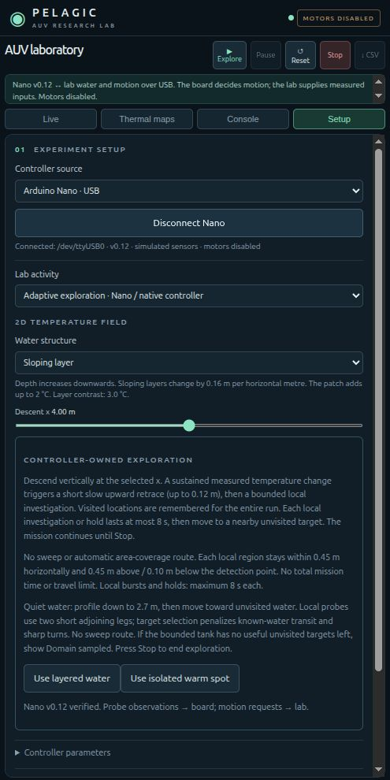

# Pelagic — adaptive thermal sampling lab

Arduino Nano firmware and a local 2D laboratory for exploring how an underwater vehicle can spend more measurements near changing temperature boundaries, while accounting for probe response delay.

**Research prototype, firmware v0.15.** The controller has been tested on a classic ATmega328P Nano over USB. Water, position, depth and vehicle dynamics are simulated. Real sensor acquisition, underwater localization, onboard storage and physical propulsion are not integrated. Motor outputs are disabled. This is not a field-ready AUV or evidence of Arctic deployment.



## Current experiment

The primary research experiment is a 0–1 m vertical profile. A new forward sensor model estimates local temperature and gradient without differentiating noisy readings. A response-aware speed governor uses reliability gates, assumed probe lag and an upper lag bound. Legacy adaptive, fixed-fast/medium/slow and an ungated ablation remain available. [Methods and mixed evaluation results](docs/RESEARCH_V015.md) describe what the experiment establishes and what it does not.

The secondary 2D explorer keeps bounded partial upward inspections (8 s), nearby unvisited-water sampling (10 s total), return to its saved descent checkpoint, resumed descent and eventual surfacing. Full retrace feasibility is now checked before movement; a partial inspection is not labelled a resolved boundary. Passage memory is not temperature confidence.

The classic Nano has two firmware images because both experiment families together exceed its flash capacity: **research** (default) and **exploration**. The native lab includes both. Neither image integrates real sensor drivers or enables motors. No PDE solver is required for these local regression experiments.

## Run the lab

Requirements: Python 3.10+ and a C++11 compiler available as `c++`. Linux is the currently tested platform. Node.js 18+ is only needed for browser-model tests. No frontend package installation is required.

```sh
python3 -m venv .venv
source .venv/bin/activate
python -m pip install -r requirements.txt
python lab/server.py
```

Open [127.0.0.1:8765/demo2d](http://127.0.0.1:8765/demo2d). Choose **Adaptive exploration**, select layered water, then Run exploration. Offline mode needs no hardware. Free swim offers keyboard-controlled browser motion; Adaptive profile runs the separate vertical profiling experiment.

The lab compiles an isolated native library under `build/lab/` at startup. Full session CSVs persist in `output/runs/`; the screen retains the latest 10,000 rows and CSV export reads the complete session. Reset starts a new file without deleting the old run. The console keeps its latest 500 lines. Only one process may own a Nano USB port.

## Run the proposal experiment

Open **Research → Compare six strategies** after stopping a live run, or:

```sh
python3 tools/compare_profiles.py --repeats 20
```

Runs save immutable manifests, source hashes, raw samples and diagnostic/metric files under unique `output/experiments/research/` directories. The quick UI comparison is for development. [The research guide](docs/RESEARCH_V015.md) explains frozen policies, independent evaluation, paired intervals, missing coverage and offline rescoring. The 30-scenario held-out study did **not** establish consistent superiority over fixed-medium: failures and mixed effects are reported rather than hidden.

## Connect a classic Nano

1. Install the Arduino AVR Boards package and Servo library using Arduino IDE or Arduino CLI.
2. Open `firmware/auv_nano/auv_nano.ino`. Select Arduino Nano / ATmega328P and your board's serial port. A board with an older bootloader may need the corresponding IDE processor option.
3. Keep `SIMULATED_SENSORS=true` and `ENABLE_MOTOR_OUTPUTS=false`. Upload the sketch for vertical research. Use `bash tools/build_nano.sh exploration` for 2D exploration instead.
4. Close Serial Monitor, start the lab, select Arduino Nano USB, and click Connect Nano. The lab verifies the firmware identity, simulated-sensor mode and disabled motor outputs and advertised image capabilities before allowing commands.

Auto-selection accepts one recognized FTDI, CH340 or CP210x USB adapter. If several are connected or your adapter is different, choose its port explicitly:

```sh
python lab/server.py --serial-port /dev/ttyUSB0
```

The USB adapter is not proof of board identity; the firmware handshake performs that check. Opening a classic Nano serial port resets the board. Exploration stops on missing observations; use Stop/Reset before disconnecting. The web server binds to loopback and is not designed for public hosting.

Arduino CLI example after installing its core and Servo library:

```sh
bash tools/build_nano.sh research
bash tools/arduino.sh upload --fqbn arduino:avr:nano:cpu=atmega328 --port /dev/ttyUSB0 --input-dir build/nano-v015-research --verify
```

`tools/arduino.sh` also supports either an existing local CLI installation or `arduino-cli` on PATH. Do not connect actuators expecting physical control from this simulated-sensor firmware.

## Checks

Stop the lab server first:

```sh
bash tools/test.sh
python3 tests/lab_test.py
python3 tests/research_test.py
node tests/keyboard_test.mjs
node tests/demo_model_test.mjs
node tests/thermal_map_test.mjs
node tests/survey_planner_test.mjs
```

`tools/verify_nano_exploration.py` is an optional motor-disabled physical-board/virtual-water test requiring a connected, uploaded Nano. It exercises control decisions, eight-second limits, spatial memory and operator Stop. It is not a hydrodynamic or real-sensor validation.

## Research scope and documentation

- [v0.15 research model, experiment and results](docs/RESEARCH_V015.md)
- [Review disposition and remaining physical work](docs/REVIEW_RESPONSE_V015.md)
- [Nano image selection, protocol and diagnostics](docs/NANO_V015_RESEARCH.md)
- [Probe calibration and vertical rig](docs/PROBE_CALIBRATION.md)

- [v0.14 bounded search, checkpoint return and surfacing](docs/NANO_V014_PROFILE_RETURN.md)
- [Original proposal review and research comparison](docs/RESEARCH_ALIGNMENT_V013.md)
- [v0.12 trajectory and unchanged USB frame](docs/NANO_V012_BOUNDED_LOCAL.md)
- [Temperature probes and response-time experiment](docs/TEMPERATURE_PROBES.md)
- [Local laboratory guide](lab/README.md)
- [Electronics notes](docs/electronics.md)
- [Moving from simulation to real hardware](docs/NANO_NATIVE_FIRMWARE_ROADMAP.md)
- [Contributing](CONTRIBUTING.md)

Evaluate boundary-depth error against an independent reference profile, travelled distance, time and spatial sampling support. Logged simulated energy is not measured energy. Visited cells indicate passage, not independently resolved temperature samples. Sensor lag, position uncertainty, calibration and the eight-second visit policy need physical validation.

The research inspiration is [Adaptive Tracking of the Barents Sea Polar Front Using an Autonomous Underwater Vehicle](https://ntnuopen.ntnu.no/ntnu-xmlui/handle/11250/3175522). This project is a simplified independent student prototype, beginning with tank-scale length–depth exploration; it does not reproduce or claim validation of that field study.

Older `docs/NANO_V*.md`, `archive/` and comparison helpers describe historical policies. Generated logs, research PDFs, local tools and machine configuration are excluded from the public source release. [MIT license](LICENSE).
